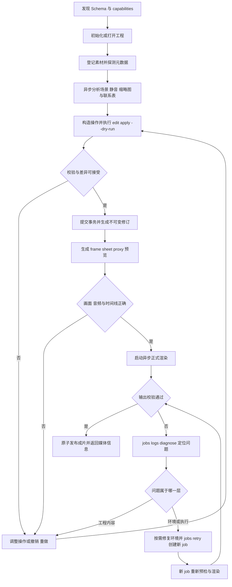
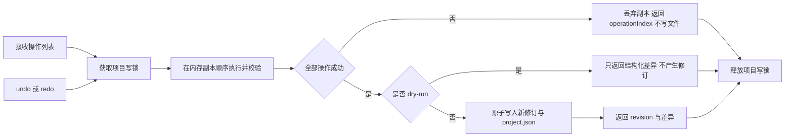
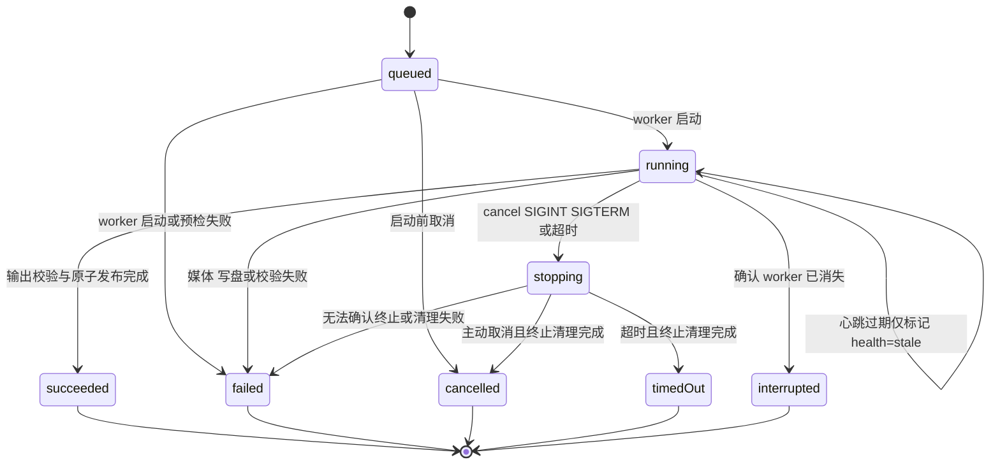
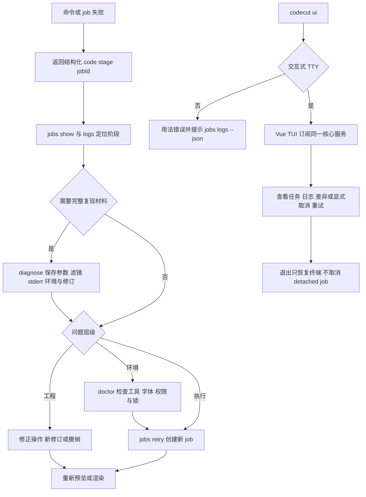

# 无界面 AI 剪辑工具 Spec

## Why

当前项目已经证明“代码时间线 + FFmpeg”可以剪辑普通视频，但示例仍把素材和镜头写死。下一步应做一套 **AI 能完整操作、也能自行排错的本地剪辑工具**：AI 可以认识素材、修改工程、检查画面、追踪异步任务、定位失败、撤销错误并导出成片，全程不需要人替它点剪辑界面。

技术选择是“别人的成熟内核 + 我们的剪辑工程与自动化层”：FFmpeg / ffprobe 负责媒体处理；Node.js + TypeScript 负责 CLI、异步任务、工程状态和诊断；Vue TUI 只负责可选的本地终端诊断仪表盘。范围不按开发复杂度裁掉功能，而按**是否给 AI 操作或问题定位带来实际价值**划分。

## What Changes

- 新增 `codecut` 非交互 CLI，所有写操作同时支持直接修改 JSON 和结构化编辑操作。
- 新增版本化 JSON 工程，覆盖素材库、多轨视频/音频、文本字幕、镜头参数、转场和输出设置。
- 新增素材管理：登记、列表、探测元数据、缩略图、素材总览、场景变化和静音区间分析。
- 新增结构化编辑：增删轨道、添加/裁切/移动/拆分/删除镜头、修改参数、导入字幕，并支持 dry-run 和事务式失败回滚。
- 新增工程管理：初始化、查看、校验、修订历史、差异、撤销和重做。
- 新增 FFmpeg 多轨渲染：裁切重排、速度变化、画面变换、透明度、跨轨合成、音频混合、字幕和转场。
- 新增无界面预览：单帧 PNG、带时间码联系表、低码率可播放代理视频，预览与正式渲染共用时间线语义。
- 新增异步任务系统：有界并发、前台等待或后台执行、进度、超时、取消、崩溃恢复和持久化任务记录。
- 新增排错系统：`doctor`、`jobs`、`logs`、`diagnose`、详细错误码、诊断包和可重放 FFmpeg 参数/滤镜图。
- 新增可选 `codecut ui` 终端诊断仪表盘，展示任务、日志、进度、预览文件位置和修订差异；它不是第二套剪辑器，也不是 AI 必须使用的接口。
- 新增 AI 自发现能力：JSON Schema、能力清单、统一 `--json` 结果和稳定退出码。
- 提供使用仓库现有素材的完整示例，以及覆盖异步与异常路径的离线端到端测试。
- 保留现有 Python v1、v4 和 20 秒示例的行为，不重写旧工程。

## 业务流程与状态流

以下流程是实现边界：AI 始终通过 JSON/CLI 驱动，TUI 只是同一核心服务的观察与显式操作入口。

### 1. AI 剪辑主流程

### 2. 事务编辑与修订流程

undo/redo 也走同一项目写锁和事务写入；撤销后的新编辑截断重做分支，渲染和分析不进入编辑历史。

### 3. 异步 job 生命周期

`retry` 不把旧 job 改回 `queued`，而是创建带 `retryOf` 的新 job，默认重放原工程修订和素材快照并重新预检；旧状态、日志和诊断永久保留。`jobs wait` 只等待现有 job，不创建新任务。`render --dry-run` 只生成执行计划，不创建 job、不启动编码。

### 4. 排错与 Vue TUI 观察流程

### 流程一致性检查结论

| 检查点 | 结论与约束 |
| --- | --- |
| AI 与 UI 边界 | 主流程不经过浏览器或 TUI；除 `codecut ui` 外均可非交互执行并返回 JSON。 |
| dry-run 与只读操作 | edit dry-run 不写文件、不产生修订；render dry-run 不创建 job、不编码；分析和渲染不产生编辑修订。 |
| 修订一致性 | 编辑只在项目写锁内修改权威工程；渲染固定不可变修订与素材状态，允许后续编辑而不污染进行中的输出。 |
| 锁与死锁 | 不嵌套持有项目写锁和输出路径锁；编辑只持项目写锁，渲染固定修订后仅争用输出路径锁。 |
| 任务终态 | succeeded、failed、cancelled、timedOut、interrupted 互不混用；只有完成输出校验和原子发布才能 succeeded。 |
| 心跳与崩溃 | 心跳过期只设置 `health=stale` 并告警；确认 worker 消失后才设置 interrupted，存活但卡住的任务由超时或显式取消处理。 |
| 取消与重试 |  queued 可直接取消，running/stopping 必须确认子进程终止并清理；retry 永远是新 job，默认不自动重试。 |
| 输出安全 | 所有发布都走临时文件和原子替换；失败、取消、超时和中断保留旧目标，不留下伪装成功的残缺输出。 |
| TUI 与实验 API | 退出观察界面不取消 detached job；Vue TUI 实验日志适配器失败不影响普通 CLI、任务控制或诊断。 |

## 范围决策：做什么、为什么

| 要做的能力 | 对 AI 的实际价值 |
| --- | --- |
| 素材库与元数据 | AI 先知道素材、时长、轨道和画幅，才能选择镜头，而不是猜文件名。 |
| 缩略图、素材联系表、场景/静音分析 | AI 能用图片和时间信息定位可用内容、动作段落及可剪区间。 |
| 多轨视频与音频 | 支持 B-roll、画中画、字幕、配乐和原声混合，不局限于单路拼接。 |
| 结构化编辑命令 | AI 可用明确操作修改工程，避免手工重写整份 JSON 引入错误。 |
| 参数化镜头与字幕 | 裁切、速度、位置、缩放、透明度、音量、淡入淡出和文本都可复现、可 diff。 |
| 单帧、时间线联系表、代理视频 | 分别满足 AI 精细看图、快速浏览全片、人类直接播放检查。 |
| 工程历史、差异、撤销、重做 | AI 可以尝试并恢复，不需要 GUI 撤销按钮。 |
| 异步任务与取消 | 长渲染和批量素材分析不必阻塞其他工作，卡死任务可发现、可终止。 |
| 结构化日志与诊断包 | 失败时能定位到工程字段、操作、FFmpeg 阶段和原始 stderr，而不是只得到“失败”。 |
| 本地终端诊断仪表盘 | 人类可在终端集中看进度、日志、诊断位置和差异；AI 仍使用同一核心服务的 JSON/CLI，不依赖终端界面。 |
| Schema 与 capabilities | AI 能自行发现字段、操作和转场，不依赖记忆或阅读全部源码。 |
| 原子写入、锁与覆盖保护 | 避免并发编辑、失败渲染或错误操作破坏已有工程和成片。 |

## 范围决策：不做什么、为什么

| 不做的能力 | 理由（不是开发复杂度） |
| --- | --- |
| 剪辑 GUI、鼠标拖拽和按钮式参数面板 | 它们不增加 AI 的剪辑能力；对应操作全部由结构化命令提供。终端诊断仪表盘只用于观察与排错，不维护第二套剪辑语义。 |
| 独立的 Vue + Vite 浏览器诊断面板 | Vue TUI 已覆盖任务与日志排错，视觉检查由 PNG、联系表和代理 MP4 承担；重复增加浏览器入口不带来新的 AI 操作能力，也不是用户指定工具的必要用途。 |
| 实时交互播放器内核 | AI 更需要确定性抽帧、联系表和可播放代理文件；代理视频仍保留人工播放能力。 |
| 内置 LLM、视觉理解、语音转文字或生成式模型 | 当前 AI agent 已负责理解和决策；转写结果可通过 SRT/文本镜头输入，避免绑定模型、账号和网络。 |
| 通用关键帧动画引擎 | 这是 MotionGit / 现有程序化页面的动画领域；本工具负责剪辑，可接入外部渲染好的动画素材。 |
| 自研编解码或滤镜内核 | 自研不会改善 AI 操作，FFmpeg 已有成熟实现；我们的价值在工程语义、异步编排与可诊断性。 |
| 声称无损兼容 MotionGit、Premiere、达芬奇等异构工程 | 语义并非一一对应，假兼容会误导 AI；开放 JSON 是本工具的可验证源格式。 |
| 云账号、在线协作和远程权限服务 | 属于外部平台职责；本地 CLI、任务文件和 API 已能被自动化系统调用。 |

以上边界不排除以后增加明确、可验证的适配器；本期只不承诺无法保证语义一致的能力。

## 技术选型调研结论（截至 2026-11-17）

### Python 与 Node 都能做，但职责不同

| 维度 | Python | Node.js + TypeScript | 本项目判断 |
| --- | --- | --- | --- |
| 外部进程并发 | `asyncio` 能并行运行和监控多个子进程，`TaskGroup` 提供结构化并发并聚合异常。[cite:1][cite:2] | `child_process` 提供异步进程、流、`AbortSignal` 和超时；Promise 组合自然。[cite:3] | 都可行，不构成“Python 不能做”的理由。 |
| 超时与取消 | 需要在协程取消后显式清理外部进程；`Process.wait()/communicate()` 的超时由 `wait_for()` 等外层机制实现。[cite:1] | 可直接使用取消信号和超时；Execa 进一步提供取消、延迟强杀和跨平台终止处理。[cite:3][cite:4] | 对大量 FFmpeg 任务，Node + Execa 的生命周期代码更直接。 |
| 大日志与流 | 必须持续消费 stdout/stderr，避免 PIPE 缓冲区死锁。[cite:1] | stdout/stderr 本身为流，Execa 支持逐行迭代和自定义日志。[cite:5] | 两者都必须流式处理；禁止无界内存收集。 |
| 异常信息 | Python traceback、ExceptionGroup 对并发异常很有价值。[cite:2] | Execa 错误带命令、时长、退出状态、超时/取消标记和输出，并支持 verbose/custom logging。[cite:5] | Node 更贴合“外部媒体进程排错”这一主场景。 |
| 异步上下文 | 可用 `contextvars` 等机制。 | `AsyncLocalStorage` 可跨异步调用保存 job/stage 上下文，但仍需处理上下文丢失风险。[cite:6] | Node 可用，关键事件仍显式携带 job ID，不只依赖隐式上下文。 |
| 现有代码协同 | 当前 v1/v4 和图像算法主要是 Python。 | 新工具主要编排 FFmpeg，不依赖 NumPy/Pillow；必要时可把旧 Python 脚本作为外部任务调用。 | 旧 Python 保留，新 CLI 不为复用语言而绑定进程模型。 |
| Schema 与诊断 UI | 可独立提供 JSON Schema 和 Web 服务。 | CLI、任务核心和 Vue TUI 仪表盘可共享 TypeScript 类型、Schema 和错误模型。 | Node 减少 CLI 与终端诊断视图之间的重复定义。 |

**决定：新工具采用 Node.js 22+、TypeScript、Execa、JSON Schema 校验和 Node 内置测试能力；FFmpeg 仍是唯一媒体内核。** CLI 参数解析、Schema 校验和日志实现保持小型、明确，不为技术栈再引入一套应用框架。现有 Python 工程不迁移。

### 对微信文章与 Vue TUI 的核实

- 用户给出的文章是《Vue 终于杀进终端界！这个开源项目让 CLI 开发像写网页一样简单》，所指工具为 **Vue TUI**，包名 `@simon_he/vue-tui`，官方仓库为 `Simon-He95/vue-tui`，作者是 **Simon He**；它不是尤雨溪的 Vue CLI，也不是 Vite。[cite:7][cite:8][cite:13]
- Vue TUI 是 Vue 3 终端 UI 工具包，同一组件模型可渲染到浏览器 DOM、真实 CLI stdout 和 headless 测试；发布包支持 Node.js `>=16.17`、Vue `>=3.3.0 <4`，与本项目 Node.js 22+ 选型兼容。本项目只采用 **真实终端 stdout + headless 测试**，不再设置 Vue + Vite 浏览器诊断面板；视觉检查仍由 PNG、联系表和代理 MP4 文件承担。[cite:8][cite:9][cite:13]
- 可直接复用稳定的 `createTerminalApp()`、`createStdoutRenderer()`、`createStdinDriver()`、`installTerminalCleanup()` 以及布局、文本、列表、选择和对话框组件，减少终端绘制、输入、resize 和终端状态恢复代码。[cite:9][cite:10]
- `TLogView` 与 `createAppendOnlyLogStore()` 能提供保留窗口、可见行渲染、搜索和日志跟随，适合 FFmpeg 长日志；但它们目前位于 `/experimental`，必须隔离在日志视图适配器中，锁定依赖版本并做契约测试，普通 `logs --follow` 始终作为稳定后备路径。[cite:11]
- 官方 agent console 示例证明日志、工具状态、markdown、overlay 与 stdout runner 可以组合，但本项目不照搬对话式 agent 界面，只复用任务状态、日志和诊断展示能力。[cite:12]
- Vue TUI 官方明确把 renderer 定义为输出层，**不负责应用状态、命令执行或数据模型**；终端 cleanup 也只负责恢复 cursor、mouse mode、alt-screen 等终端状态。因此它不能替代 Execa、job store、FFmpeg progress 解析、子进程取消/强杀、锁、历史或诊断包。[cite:10]

**决定：Node.js 22+、TypeScript、Execa 与 FFmpeg 的核心选型不变；新增可选 Vue TUI 终端仪表盘。** AI 的权威接口仍是非交互 JSON/CLI；Vue TUI 只减少人类诊断界面的自研工作，不进入媒体处理和任务状态机。

## 异步、异常与排错设计

### 异步任务模型

- 素材探测/分析、联系表、代理和正式渲染都统一为带 ID 的 job；默认前台等待，`--detach` 可后台运行。
- `jobs list/show/wait/cancel/retry` 使用同一持久化 job store；retry 创建新 job，不覆盖旧诊断记录。
- 同类 I/O 任务使用有界并发，不使用无界 `Promise.all` 一次启动全部 FFmpeg。
- 工程写操作按项目串行加锁；渲染固定到不可变修订和素材状态快照，避免编辑中的工程导致半新半旧输出。
- 同一输出路径加锁，默认拒绝覆盖；并发任务不能互相替换目标文件。项目写锁与输出路径锁不得嵌套持有，避免编辑与渲染互相等待。

### 取消、超时和崩溃恢复

- FFmpeg 使用 `-progress` 的机器可读输出报告帧数、时间、速度和结束状态；stderr 单独保存，二者不混成不可解析文本。
- stdout/stderr 持续消费并写文件，内存只保留有界尾部；日志截断必须显式标记。
- 前台收到 Ctrl-C/SIGINT、终止信号或任务超时时进入统一 `stopping` 流程：先请求终止，超过宽限期再强杀，等待子进程退出并清理后分别落到 `cancelled` 或 `timedOut`。
- 取消、超时、FFmpeg 非零退出、工具启动失败、磁盘写入失败、非法进度输出和 worker 意外退出分别映射为稳定错误类型。
- job 定期写心跳；心跳过期只设置 `health=stale` 并告警，确认 worker 进程消失后才标记 `interrupted`。存活但卡住的任务由超时或显式取消处理，原目标和工程保持可用。
- 自动重试默认关闭，避免重复写入；AI 可查看失败原因后显式 `jobs retry`。

### CLI 排错入口

- `doctor` 检查 Node、FFmpeg/ffprobe、可用滤镜、字体、目录权限、临时空间及任务锁状态。
- `jobs show` 返回阶段、进度、PID、起止时间、工程修订、错误和诊断文件位置。
- `logs` 支持按 job/stage/级别查看及 follow；TTY 显示简洁进度，CI 或非 TTY 禁用动态重绘，`--json`  stdout 始终纯净。
- `--verbose` 增加阶段信息，`--debug` 保留堆栈和内部细节；正常模式不输出大段堆栈。
- `render --dry-run` 输出执行计划、工程修订、FFmpeg 参数数组和滤镜图位置，不启动编码。
- `diagnose JOB_ID` 生成诊断目录，包含环境版本、错误、参数数组、滤镜图、stderr、进度事件、相关工程修订和素材元数据；默认不包含原媒体，也不收集环境变量中的凭据。
- 退出码稳定区分：成功、用法错误、工程校验失败、媒体/FFmpeg 失败、超时、取消和内部错误；JSON 错误另含 `code/stage/jobId/path/operationIndex/retryable/diagnostics`。

### 可选终端诊断仪表盘

- `codecut ui` 使用 `@simon_he/vue-tui/cli` 的 stdout renderer 和 Vue 组件构建，只在交互式 TTY 中启动，不启动浏览器或 Web 服务。
- 仪表盘展示 job 进度、阶段、日志、诊断文件位置、素材/时间线预览文件位置和修订差异，通过同一核心服务读取 job store 与工程状态；PNG、联系表和 MP4 仍由对应预览命令生成，不依赖终端图形协议或 Vue TUI 的实验性视频组件。
- 可提供取消、重试等明确动作，但所有动作都调用同一 CLI 核心服务；退出观察界面只恢复终端并关闭视图，不默认取消 detached job。
- 高频日志通过隔离的 Vue TUI 日志适配器显示有界保留窗口；该适配器失败或实验 API 不兼容时，`jobs`、`logs --follow`、`diagnose` 和普通 CLI 仍完整可用。
- 非 TTY 下执行 `codecut ui` 返回明确用法错误并提示使用 `jobs/logs --json`；CI 不启动 TUI 时全部剪辑与诊断功能仍可完成。

## Impact

- Affected specs: 新增无界面素材库、多轨时间线、结构化编辑、工程历史、异步任务、诊断、预览、渲染和 AI 自发现能力。
- Affected code: 新增 `codecut/`（Node/TypeScript CLI、核心、任务、诊断、Vue TUI 终端仪表盘）、`examples/headless_demo.json`、`tests/`。
- Project data: 新工程目录包含权威 `project.json`、工具管理的修订/任务记录和可删除缓存；原素材默认只引用、不复制。
- Existing code: `scripts/`、`v4/`、现有 MV 配置及成片保持原行为。
- Runtime dependencies: Node.js 22+、npm 依赖、系统 FFmpeg / ffprobe 和可配置字体；Vue 3 与 `@simon_he/vue-tui` 仅用于可选 TUI；旧 Python 工程依赖不变。

## ADDED Requirements

### Requirement: 工程初始化与权威 JSON

系统 SHALL 提供 `project init`、`project show`、`project validate`，生成并读取版本化 `project.json`。工程 SHALL 表达输出设置、素材表、有序视频/音频轨道、镜头和文本；路径相对于工程目录解析，同一素材可复用。

#### Scenario: AI 创建并理解工程

- **WHEN** AI 初始化工程并请求 `project show --json`
- **THEN** 系统返回完整、稳定、可再次修改的工程结构和计算后的时间线信息

#### Scenario: 工程损坏或引用无效

- **WHEN** JSON 无法解析、版本不支持、轨道/镜头字段非法或素材引用不存在
- **THEN** 校验指出具体字段路径和原因，写操作不执行

### Requirement: 素材库与内容定位

系统 SHALL 提供素材登记、列表、移除和探测，记录路径、文件状态、时长、流、编码、分辨率、帧率和音频信息。系统 SHALL 生成素材缩略图、带时间码联系表、场景变化候选点和静音区间，并提供机器可读结果。

#### Scenario: AI 选择剪辑区间

- **WHEN** AI 登记视频并请求分析、缩略图和联系表
- **THEN** 无需播放原片即可获得媒体元数据、可视索引及候选剪辑时间

#### Scenario: 素材发生变化

- **WHEN** 已登记素材被移动、删除或文件状态改变
- **THEN** 校验指出受影响素材和镜头，不静默使用错误内容

### Requirement: 多轨时间线与镜头参数

工程 SHALL 支持多条有序视频轨和音频轨。视频轨 SHALL 支持视频、图片、颜色和文本镜头并合成；音频轨 SHALL 支持原声与独立音频混合。镜头 SHALL 支持时间线入点、时长、源入点、速度、裁切、缩放、位置、透明度、音量及淡入淡出，文本镜头 SHALL 支持字体、字号、颜色和对齐。

#### Scenario: B-roll、字幕和配乐同时存在

- **WHEN** 工程包含主视频、上层图片或文字以及至少两条音频轨
- **THEN** 渲染按时间线合成所有内容，各轨时长和同步关系与工程一致

#### Scenario: 变速镜头

- **WHEN** 镜头设置合法速度倍率并包含原声
- **THEN** 画面与音频速度同步变化，后续镜头不错位

### Requirement: 结构化编辑操作

系统 SHALL 提供 `edit apply` 接受操作列表，覆盖增删轨道、添加/裁切/移动/拆分/删除镜头、设置参数、添加文本和导入 SRT。一次提交 SHALL 是事务；`--dry-run` SHALL 只返回差异。

#### Scenario: AI 连续修改多个镜头

- **WHEN** AI 提交添加 B-roll、裁切主镜头和调整配乐音量的操作列表
- **THEN** 系统按顺序执行并返回新修订及结构化差异

#### Scenario: 操作列表中途失败

- **WHEN** 任一操作引用不存在的镜头或产生非法时间线
- **THEN** 不应用任何操作，错误指出失败操作索引和原因

### Requirement: 历史、差异、撤销与重做

系统 SHALL 为每次成功写操作生成不可变修订，记录时间、操作摘要和工程快照，并提供历史列表、修订差异、撤销和重做。只读、分析和渲染 SHALL 不制造编辑修订。

#### Scenario: AI 回退一次错误剪辑

- **WHEN** AI 完成编辑后执行撤销，随后执行重做
- **THEN** 工程先恢复到编辑前，再恢复到编辑后，原素材不被修改

### Requirement: 工程预检与能力自发现

系统 SHALL 在写入和渲染前检查工具、素材、流类型、时间范围、轨道规则、转场、字体和输出参数。`schema` SHALL 输出工程及编辑操作的 JSON Schema，`capabilities` SHALL 输出支持的镜头类型、操作、转场和导出能力。

#### Scenario: AI 不阅读源码也能构造操作

- **WHEN** AI 请求 Schema 和能力清单
- **THEN** 返回的字段、枚举和约束足以生成可被校验和编辑命令接受的请求

### Requirement: 多轨 FFmpeg 渲染

系统 SHALL 使用 FFmpeg 将合法工程渲染为 H.264 / AAC MP4，统一帧率、分辨率、像素格式、48kHz 双声道和时间基。支持同轨硬切/`xfade`、跨轨合成、音频混合、字幕、图片和颜色镜头；无原声区间补静音，最终音画等长。

#### Scenario: 多轨工程导出

- **WHEN** 用户渲染包含转场、字幕、B-roll、原声和配乐的工程
- **THEN** 输出可完整解码，画面、音频和总时长符合工程，误差不超过一帧

### Requirement: 三类无界面预览

系统 SHALL 提供 `preview frame`、`preview sheet`、`preview proxy`，分别输出时间点 PNG、带时间码联系表和低分辨率可播放 MP4，并复用正式渲染语义。

#### Scenario: AI 检查全片后定位细节

- **WHEN** AI 先生成联系表再对指定时间抽帧
- **THEN** 单帧准确呈现同一时间的正式合成结果

#### Scenario: 人类需要播放检查

- **WHEN** 用户生成代理视频
- **THEN** 得到保留完整音频和时间线的低分辨率 MP4

### Requirement: 异步任务与异常恢复

系统 SHALL 为分析和渲染提供持久化 job、进度、有界并发、前台/后台模式、超时和取消。job SHALL 固定工程修订并防止项目写锁和输出路径冲突；异常或进程消失 SHALL 终止于明确状态而非永久运行。

#### Scenario: 长任务后台运行后取消

- **WHEN** AI 以 detach 启动渲染，通过 jobs 查看进度后取消
- **THEN** 子进程在终止宽限期内退出或被强杀，job 标记取消，临时文件清理且原输出不变

#### Scenario: worker 意外退出

- **WHEN** 渲染 worker 未写完成状态即退出
- **THEN** 后续 jobs/doctor 能依据心跳和进程状态标记 interrupted，并保留已有日志供诊断

#### Scenario: 大量 FFmpeg 日志

- **WHEN** 子进程持续输出大量 stderr 和 progress
- **THEN** CLI 仍消费全部流、更新进度且不发生 PIPE 阻塞或无界内存增长

### Requirement: 排错、日志与诊断包

系统 SHALL 提供 `doctor`、`jobs`、`logs`、`render --dry-run`、`diagnose`、`--verbose` 和 `--debug`。任何失败 SHALL 能关联到 job、阶段和工程修订；媒体进程失败 SHALL 保存参数数组、滤镜图和原始 stderr。诊断目录 SHALL 默认排除原媒体和凭据。

#### Scenario: FFmpeg 参数错误

- **WHEN** 渲染在滤镜图或编码阶段失败
- **THEN** JSON 错误指出阶段和诊断位置，用户可查看原始 stderr、参数和滤镜图以复现问题

#### Scenario: 环境与权限问题

- **WHEN** 工具缺失、字体不可用、目录不可写或锁异常
- **THEN** doctor 给出具体检查项和修复方向，不把环境问题误报为剪辑内容错误

### Requirement: 终端诊断仪表盘与 CLI 同源

系统 SHALL 提供基于 Vue TUI 的可选 `codecut ui`，展示任务、日志、诊断与预览文件位置和修订差异；仪表盘的所有读取和动作 SHALL 使用 CLI 同一核心状态与服务，不另建工程、任务或渲染语义。

#### Scenario: CLI 与仪表盘观察同一任务

- **WHEN** 用户启动后台渲染并同时打开 `codecut ui`
- **THEN** 两边看到相同 job ID、进度、状态和日志，仪表盘取消后 CLI 也能观察到取消结果

#### Scenario: 退出观察界面

- **WHEN** 用户关闭正在观察 detached job 的仪表盘
- **THEN** 终端状态被恢复，后台 job 继续运行，只有显式取消动作才进入任务终止流程

#### Scenario: 非 TTY 或无界面自动化环境

- **WHEN** CI 不启动仪表盘，仅使用 CLI，或在非 TTY 中误执行 `codecut ui`
- **THEN** 前者所有剪辑、任务和诊断能力完整可用，后者返回明确用法错误并提示 JSON/普通日志命令

#### Scenario: 实验性日志组件不可用

- **WHEN** Vue TUI 实验性日志适配器初始化失败或版本契约不满足
- **THEN** 普通 `logs --follow`、诊断包和任务控制仍可使用，核心任务与媒体处理不加载该适配器

### Requirement: 非交互自动化与文件安全

除交互式 `codecut ui` 外，所有命令 SHALL 支持非交互执行、稳定退出码和 `--json`；机器可读 stdout 不得混入 FFmpeg 日志或 TUI 重绘，错误 SHALL 写入 stderr。`codecut ui` 在非 TTY 中 SHALL 返回明确用法错误。工程和媒体输出 SHALL 原子写入；默认拒绝覆盖，显式 `--force` 才允许覆盖，失败 SHALL 保留旧目标并清理临时文件。

#### Scenario: 批量自动剪辑

- **WHEN** agent 或 CI 串联素材登记、编辑、预览和渲染
- **THEN** 每一步都可仅用 JSON 和退出码判断结果，不需要 stdin 确认

#### Scenario: 导出失败

- **WHEN** FFmpeg 在已有目标文件存在且允许覆盖时失败
- **THEN** 原目标保持可用，不留下被误认为成功的新文件

### Requirement: 完整示例与离线端到端测试

项目 SHALL 提供使用 `media/railgun_omr_v4_preview.mp4` 的示例，演示素材、编辑、多轨、历史、异步任务、诊断、三类预览和渲染。测试 SHALL 使用临时合成素材，覆盖并发、取消、超时、崩溃、日志洪峰、锁冲突及 TUI/CLI 状态一致性；TUI 使用 headless terminal 测试，不依赖网络、浏览器或真实 TTY。

#### Scenario: 从空工程到成片及故障复现

- **WHEN** 测试或用户执行完整流程并注入可控失败
- **THEN** 成功路径得到预期修订、预览和 MP4；失败路径得到稳定状态、退出码和可定位诊断

## MODIFIED Requirements

### Requirement: 现有代码驱动视频工程

现有 Python v1、v4 和 20 秒 footage 示例 SHALL 保持入口、时间线和输出行为。新增 Node/TypeScript 工具 SHALL 独立实现，不强制迁移旧工程，不修改旧配置，也不通过兼容层改变旧命令。

#### Scenario: 新工具与旧工程共存

- **WHEN** 用户使用新增 CLI 或继续运行旧脚本
- **THEN** 两者互不改写对方工程，现有素材和成片不被删除或回滚

## REMOVED Requirements

无现有功能被删除。上一版尚未实现的 Vue + Vite 浏览器诊断面板由 Vue TUI 终端仪表盘替代：终端已覆盖任务/日志排错，视觉检查继续由预览文件承担，AI 的 JSON/CLI 接口不依赖任一 UI。

## Sources

- [cite:1] [Python 官方文档：asyncio Subprocesses](https://docs.python.org/3/library/asyncio-subprocess.html)
- [cite:2] [Python 官方文档：Coroutines and Tasks / TaskGroup](https://docs.python.org/3/library/asyncio-task.html#task-groups)
- [cite:3] [Node.js 官方文档：Child process](https://nodejs.org/api/child_process.html)
- [cite:4] [Execa 官方文档：Termination](https://github.com/sindresorhus/execa/blob/main/docs/termination.md)
- [cite:5] [Execa 官方文档：Debugging](https://github.com/sindresorhus/execa/blob/main/docs/debugging.md)
- [cite:6] [Node.js 官方文档：Asynchronous context tracking](https://nodejs.org/api/async_context.html)
- [cite:7] [微信文章：Vue 终于杀进终端界！这个开源项目让 CLI 开发像写网页一样简单](https://mp.weixin.qq.com/s/K1sjrTrxYOcAoHWJcXUYxA)
- [cite:8] [Vue TUI 官方仓库与 README](https://github.com/Simon-He95/vue-tui)
- [cite:9] [Vue TUI 官方文档：Vue CLI UI Components](https://github.com/Simon-He95/vue-tui/blob/main/docs/guide/vue-cli-ui.md)
- [cite:10] [Vue TUI 官方文档：CLI Stdout Renderer](https://github.com/Simon-He95/vue-tui/blob/main/docs/guide/cli-stdout-renderer.md)
- [cite:11] [Vue TUI 官方文档：Terminal Log Viewer](https://github.com/Simon-He95/vue-tui/blob/main/docs/guide/terminal-log-viewer.md)
- [cite:12] [Vue TUI 官方文档：Agent Console Example](https://github.com/Simon-He95/vue-tui/blob/main/docs/agent-console.md)
- [cite:13] [npm Registry：`@simon_he/vue-tui` 发布包元数据](https://registry.npmjs.org/@simon_he%2Fvue-tui/latest)
